# FM27 Analyst

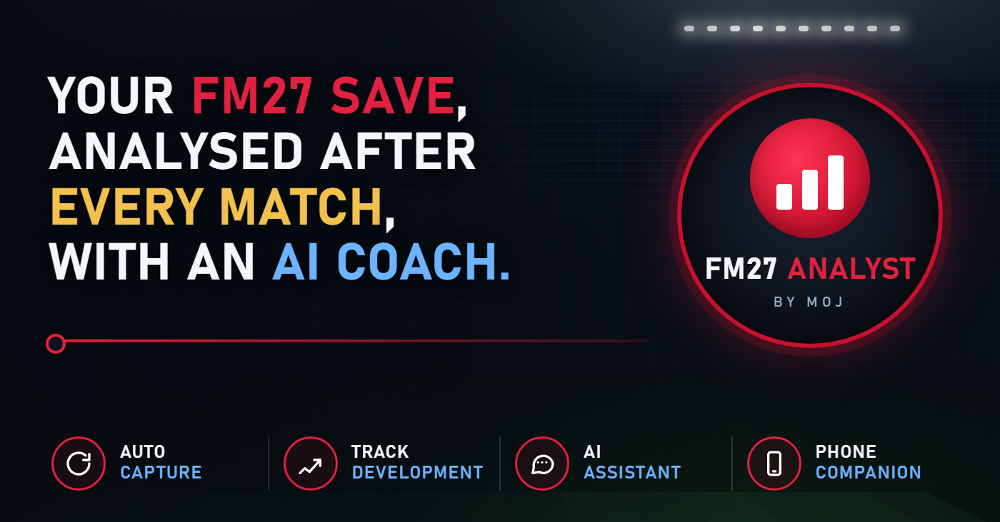

**A companion app for Football Manager 27.** It watches your save while you play, and builds a history of your squad:
- **every match:** ratings and stats;
- **over time:** attributes, CA and development;
- **fitness:** condition, sharpness and injuries.

From that history you get a dashboard, a recommended XI for the next match, and an AI assistant manager you can ask about your squad. It also works on your phone, and with **remote play** you can play FM27 from your phone too.

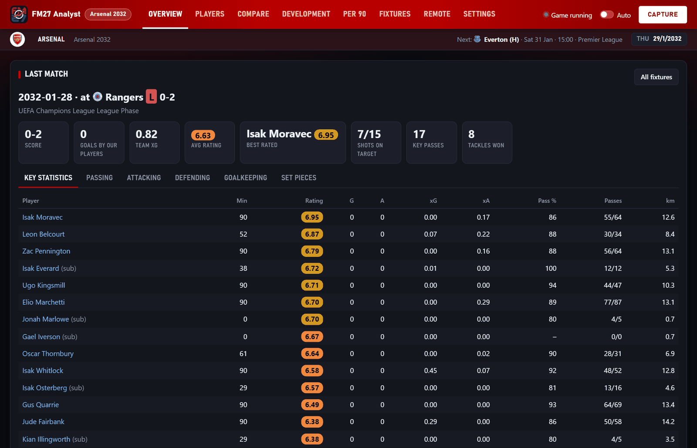

- 🔄 **Automatic.** It captures by itself after each of your matches. You never type anything in.
- 🔒 **Read-only.** It only *reads* the game's memory, and never changes the game, your save or FM27's files.
- 🎨 **Your club's colours.** The dashboard takes its colours from your club in the game, in dark or light mode.
- 💻 **Local.** Everything stays on your PC. Nothing leaves it unless you set up the AI coach, and then only your squad summary goes to the provider you choose.

> **New in 1.0.2 (out of beta):** play FM27 from your phone with [remote play](docs/updates.md#remote-play), the analyst and AI coach inside it, club crests and a new logo. See [what's new](docs/updates.md).
>
> Unofficial fan project, not affiliated with or endorsed by Sports Interactive or SEGA. For single-player saves only.

## Quick start
1. **Install [Python 3.10+](docs/guide/installation.md#1-install-python)**, e.g. `winget install Python.Python.3.12`.
2. **Download** the latest release from the [Releases page](https://github.com/lastrider04/FM27-Analyst/releases) (**Source code (zip)**). Extract it to a permanent folder such as `Documents\FM27-Analyst`.
3. **Double-click `install.bat`.** It installs everything and adds **FM27 Analyst** shortcuts.
4. **Start FM27, load your save, and open FM27 Analyst.** Choose your club on the Overview, then press **Capture**.

The full walkthrough is in [Installation](docs/guide/installation.md) and [Getting started](docs/guide/getting-started.md).

## Guide

| | Page | What's in it |
|---|---|---|
| 1 | **[Installation](docs/guide/installation.md)** | Requirements, installing Python, `install.bat`, command-line install, updating, uninstalling |
| 2 | **[Getting started](docs/guide/getting-started.md)** | First start, choosing your club, captures and auto-capture, the top bar, appearance (club colours, dark and light), running in the background |
| 3 | **[Using the dashboard](docs/guide/dashboard.md)** | Overview and next-match picks, Players, player pages, Compare, Development, Per 90, Fixtures and match reports |
| 4 | **[AI coach](docs/guide/ai-coach.md)** | Asking questions, and setting up the ChatGPT plan, OpenAI, OpenRouter, Ollama or LM Studio; coach instructions; privacy |
| 5 | **[Phone app](docs/guide/phone.md)** | How it works, choosing a connection method, installing it on your phone, what a phone can do |
| | ↳ [Local network (IP and port)](docs/guide/phone-local-network.md) | On home Wi-Fi only: the simplest setup. ✅ Tested. |
| | ↳ [Tailscale](docs/guide/phone-tailscale.md) | Anywhere, private, with HTTPS and no router changes. ⚠️ Untested suggestion. |
| | ↳ [Reverse proxy](docs/guide/phone-reverse-proxy.md) | Your own domain via NGINX Proxy Manager (✅ tested), or Caddy or nginx (untested): DNS, port forwarding, Let's Encrypt |
| | ↳ [Cloudflare Tunnel](docs/guide/phone-cloudflare-tunnel.md) | Your own domain with no open ports. ⚠️ Untested suggestion. |
| | ↳ [Signing in and pairing](docs/guide/phone-sign-in.md) | Password, Google sign-in (OAuth client setup), pairing codes, managing devices |
| | ↳ [Windows Firewall](docs/guide/firewall.md) | Which rule you need for each method, adding, checking and removing it |
| | **[Remote play](docs/guide/remote-play.md)** | Play FM27 from your phone: live picture and touch controls, smooth video, the analyst's picks, alerts and phone notifications when FM27 needs you |
| 6 | **[Game snapshots and backups](docs/guide/game-snapshots.md)** | Separate histories per save or job, new games, backups, restoring, moving to a new PC |
| 7 | **[Troubleshooting](docs/guide/troubleshooting.md)** | Install, capture, game-update banner, data, coach and phone problems |
| 8 | **[Privacy, security and your data](docs/guide/privacy-and-data.md)** | What's read, what's sent where, the `data\` folder, how secrets are stored |
| 9 | **[For developers](docs/guide/development.md)** | Running from source, tests, code layout, game builds, contributing |
| | **[Updates](docs/updates.md)** | What's new in each version |

## Features at a glance

<table>
<tr>
<td width="50%"><a href="docs/guide/dashboard.md#player-page">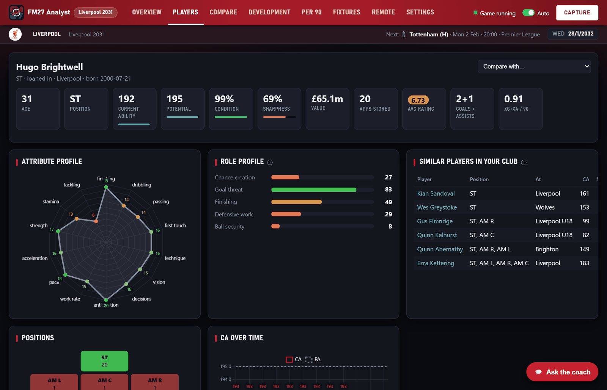</a> <b>Player pages</b>: attribute radar, CA history, match log, role profile, similar players.</td>
<td width="50%"><a href="docs/guide/dashboard.md#development">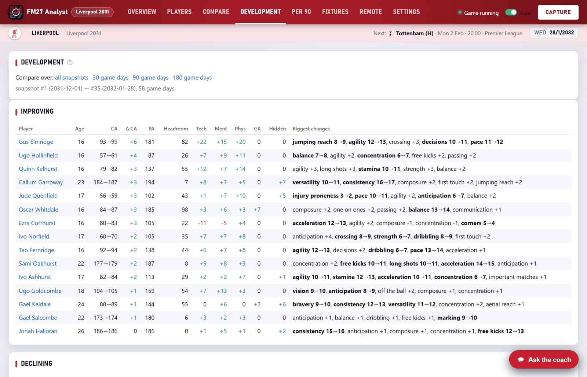</a> <b>Development</b>: who's improving or declining, by CA and attribute group.</td>
</tr>
<tr>
<td><a href="docs/guide/dashboard.md#per-90">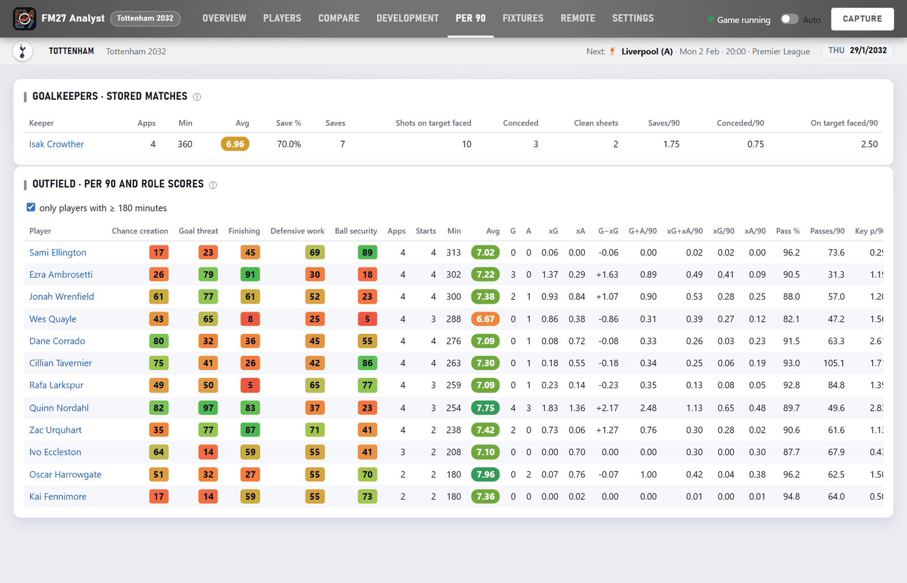</a> <b>Per 90 and role scores</b>: goalkeeping, chance creation, goal threat, finishing, defensive work, ball security.</td>
<td><a href="docs/guide/dashboard.md#fixtures-and-match-reports">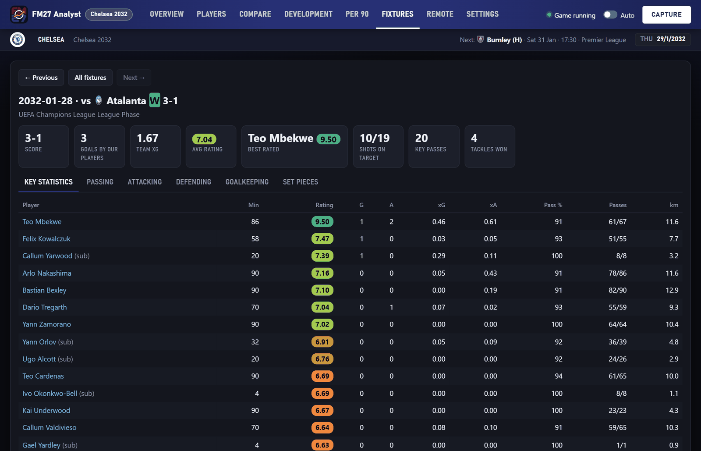</a> <b>Match reports</b>: every player's stats from every captured match.</td>
</tr>
<tr>
<td><a href="docs/guide/ai-coach.md">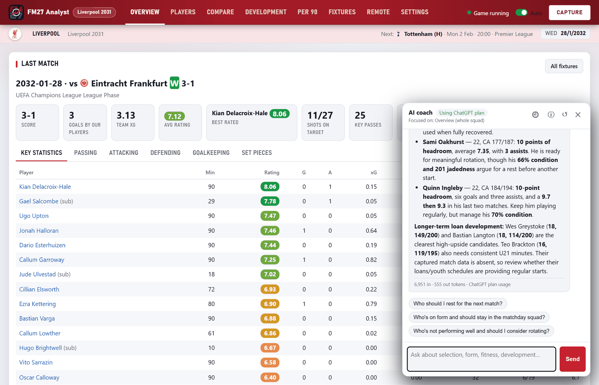</a> <b>AI coach</b>: ask who to rest, rotate or develop. It answers from your data.</td>
<td><a href="docs/guide/phone.md">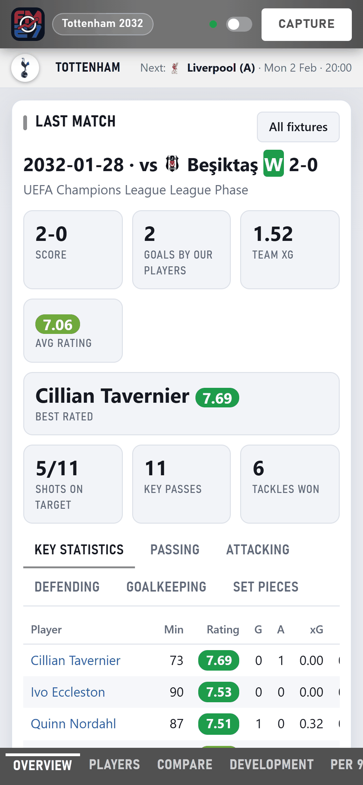 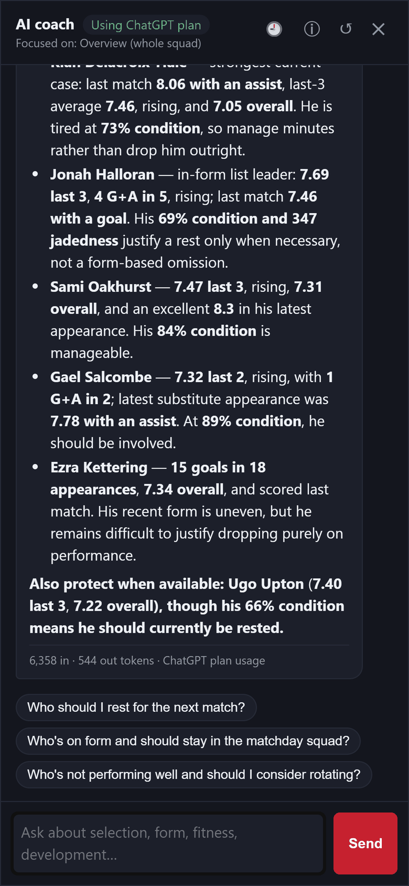</a> <b>Phone app</b>: installable, works anywhere, with two-step pairing.</td>
</tr>
<tr>
<td><a href="docs/guide/remote-play.md">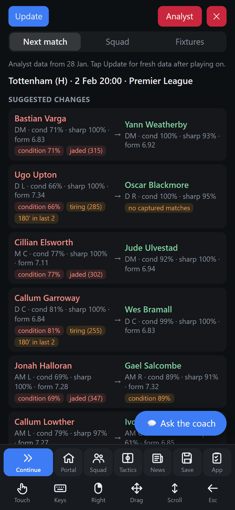 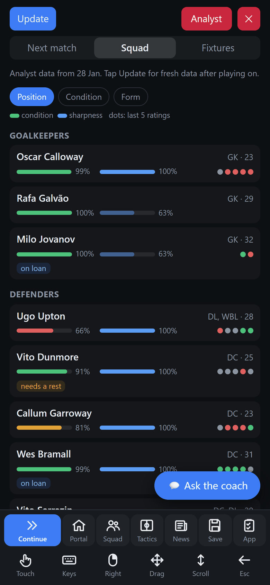</a> <b>Remote play</b>: play FM27 from your phone, with the analyst and the coach over the game.</td>
<td><a href="docs/guide/getting-started.md#appearance">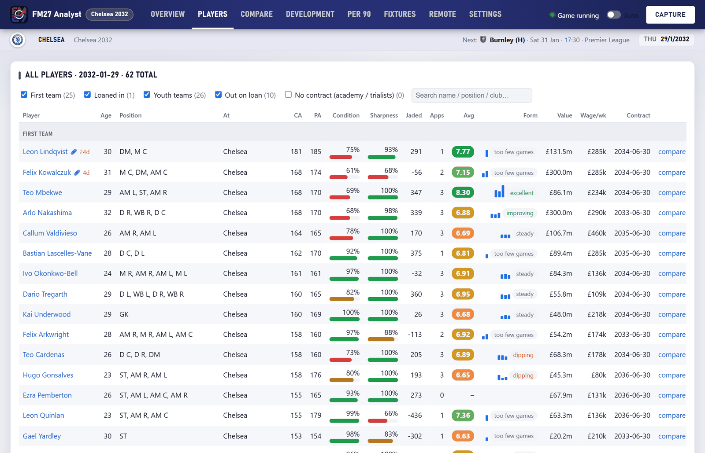</a> <b>Your club's look</b>: club colours and crests, in dark or light mode.</td>
</tr>
</table>

## Requirements
- **Windows** 10 or 11.[^platforms]
- **Football Manager 27** (PC), tested on the release build (`e6edaa71ecd9`), the 11 November update (`f2bf83294162`) and the latest update (`df0c5c4104b2`). After a game patch it tries its existing offsets and carries on if they still fit; otherwise it tells you it needs an update; see [Troubleshooting](docs/guide/troubleshooting.md#fm27-has-been-updated-banner).
- **Python** 3.10 or newer.
- **Edge or Chrome** (Edge comes with Windows).

## Help and feedback
- **Problems:** see [Troubleshooting](docs/guide/troubleshooting.md), or [open an issue](https://github.com/lastrider04/FM27-Analyst/issues).
- **Ideas and pull requests** are welcome; see [For developers](docs/guide/development.md).
- **Enjoying it?** [Buy me a coffee](#support) ☕

## Support
FM27 Analyst is free. If it's useful to you and you'd like to say thanks, you can buy me a coffee ☕. It's entirely optional and very much appreciated.

[buymeacoffee.com/moj1901](https://buymeacoffee.com/moj1901)

## Licence
[GPL-3.0](LICENSE). You're free to use, change and share FM27 Analyst. If you share a modified version, you must share its source under the same licence.

[^platforms]: **Other platforms:** FM27 Analyst has only been built and tested on Windows. The Python code could probably be adapted for macOS or Linux without too much work, but that hasn't been attempted yet. The Windows-specific parts are: reading the game's memory (`reader/process.py`, `reader/memory.py`), encrypting secrets with DPAPI (`keystore.py`), the global hotkey (`capture/hotkey.py`), and the installer and shortcuts (`install.bat`, `tools/make_shortcut.ps1`, `launch.py`). The dashboard, analytics, coach and phone app are plain Python and web code. Contributions are welcome; see [For developers](docs/guide/development.md).
