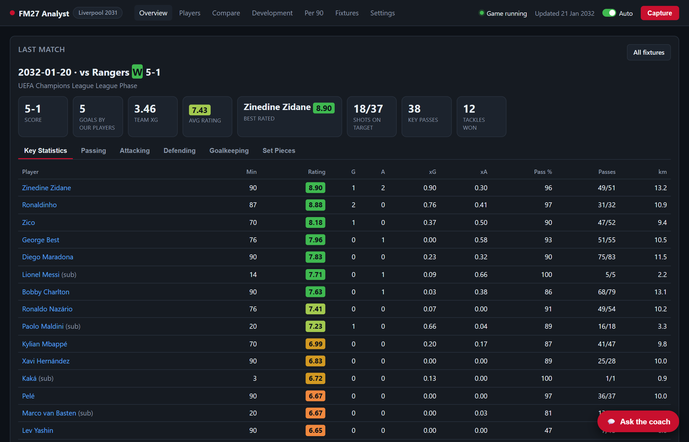
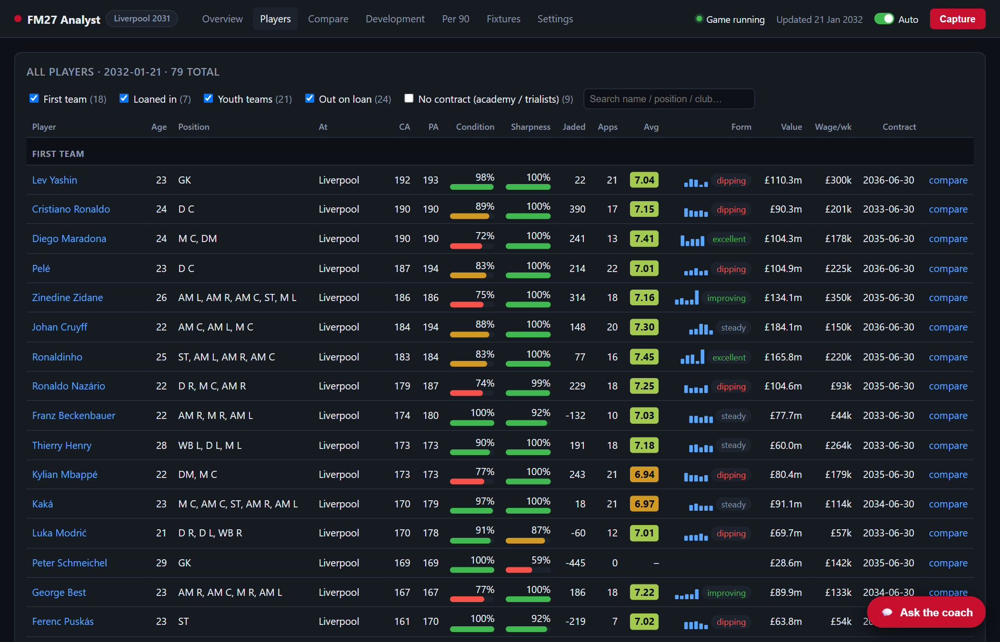
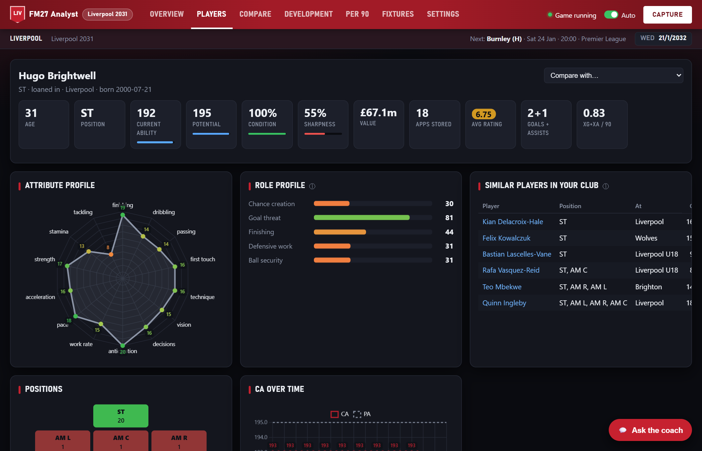
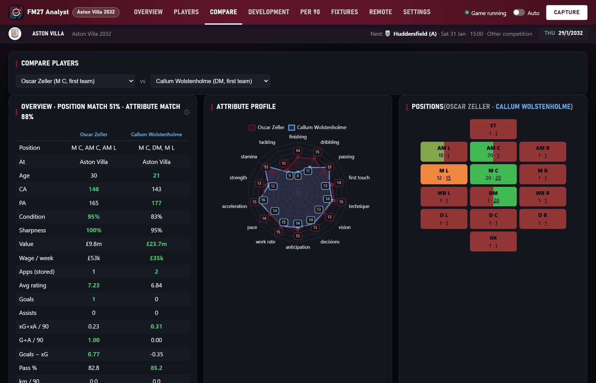
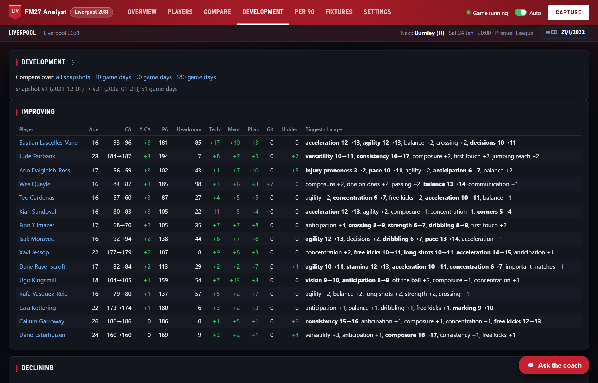
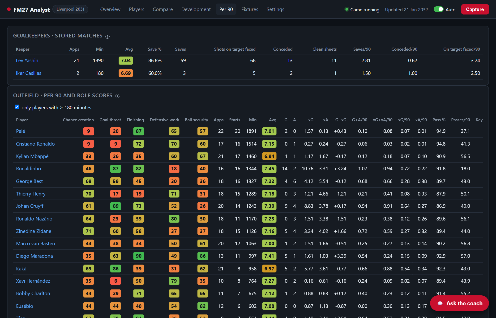
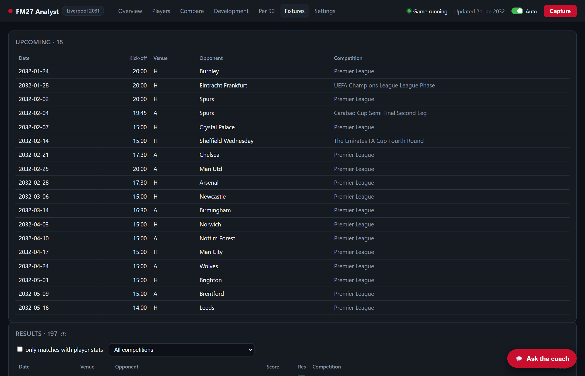
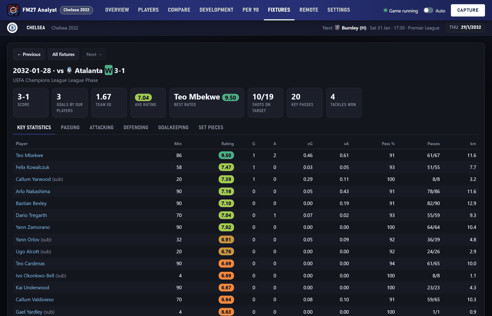

# Using the dashboard

[← Getting started](getting-started.md) · [Guide index](../../README.md#guide) · Next: [AI coach →](ai-coach.md)

Every page reads from your captured history, so it works even when FM27 isn't running. The **ⓘ** icons next to titles explain each card, and short column headers explain themselves when you hover over them.

- [Overview](#overview)
- [Players](#players)
- [Player page](#player-page)
- [Compare](#compare)
- [Development](#development)
- [Shortlist](#shortlist)
- [Tactics](#tactics)
- [Per 90](#per-90)
- [Fixtures and match reports](#fixtures-and-match-reports)
- [Ratings colours](#ratings-colours)

## Overview

The page you'll use most:

- **Last match:**
  - the score and KPI tiles (goals, team xG, average rating, best-rated player, shots on target, key passes, tackles won);
  - every player's stats, in tabs: *Key statistics, Passing, Attacking, Defending, Goalkeeping, Set pieces*.

  Click a player's name to open their page.
- **Team form:** your recent results. Click one for its match report. Upcoming fixtures are underneath.
- **Alerts:**
  - injured players, with the expected return date;
  - low condition, high jadedness and low match sharpness.
- **In form:** the best performers over the last 5 captured matches, from ratings and goal involvements. A player needs at least 2 appearances in those matches.
- **Recommended for the next match:** the app's own suggestions, from your captured data:
  - **Picks:** the best-placed starters, using form (with recent trend), goal threat (xG + xA per 90), ability (CA) and fitness.
  - **Swaps:** for anyone who should sit out, a like-for-like replacement, preferring players natural in that position.
  - **Rest:** players to rest. A player is **unfit** if injured, below 85% condition or above 300 jadedness. **Caution** flags show for 85–90% condition, 200–300 jadedness, sharpness under 70%, or 170+ minutes in the last two matches.

  Injured players are never picked. The **ⓘ** shows which capture the condition figures come from.

## Players

Everyone at the club, grouped as **First team, Loaned in, Youth teams, Loaned out**. Use the chips at the top to choose which groups show; your choice is remembered.

For each player you get:
- age, position and where they're playing;
- CA/PA;
- condition, sharpness and jadedness;
- appearances, average rating and a form sparkline;
- value, wage and contract end.

**Filters:** search by name or club, pick an age band, or click positions to show only the players who can play there
(pick several to combine them). **★ Top 5** shows your five best players right now (highest CA), and **🌱 Most
promising** your five best prospects (21 or under, highest PA). Those players also carry the ★ or 🌱 next to their
name. **Clear filters** resets them; your choice is remembered.

Injured players have a 🩹 badge. Click a column header to sort, and click a row to open the player.

## Player page

- **Header:** position(s), age, CA/PA, value, contract and injury status.
- **Attributes:** a colour-coded radar, plus every attribute grouped Technical / Mental / Physical (or Goalkeeping).
- **CA history:** how their ability has changed across your captures.
- **Match log:** each captured match with minutes, rating and key stats.
- **Role profile:** their [role scores](#per-90) compared with the rest of the squad.
- **Similar players:** squad-mates with the closest attribute profile and position. Click one to compare them.
- **Goalkeepers only:** save %, clean sheets and goals conceded per 90.

## Compare

Two players side by side: attributes, CA/PA and their stats. Choose the two players at the top, or click **Compare with…** on a player page.

## Development

Who's improving and who's declining:
- **The period:** compare **all snapshots**, or the last **30, 90 or 180 game days**. The line under the choices shows which two captures are compared.
- **Improving** and **Declining** tables. For each player:
  - age and position(s);
  - CA before → after and the change (Δ CA);
  - PA and **headroom** (PA − CA, their room to grow);
  - the total change in each attribute group: Technical, Mental, Physical, Goalkeeping and Hidden;
  - **Biggest changes:** the attributes that moved most. A green or red outline means the 1–20 value in the game moved:
    you see the new value in its attribute colour and ▲ or ▼ by how much. A plain one is a smaller **raw** change that
    hasn't moved the 1–20 number yet. Hover one for the details.
- **Filters:** the same search, age and position filters as Players. Each table shows the top 15 until you filter, or
  click **Show all**.

Development needs at least two captures some game time apart.

## Shortlist
Follow players you might buy: how their value, contract and ability change over time, to judge whether they're a good
buy and when to bid.

**Only players on your FM27 shortlist called `FM Analyst` show up.** In the game, create a shortlist with exactly that
name (capital F, M and A, one space) and add players to it. They appear here after the next capture. Take a player off
it and they disappear here at the next capture, history and all. Your other shortlists are ignored. The page explains
this the first time you open it; after that it's in the ⓘ next to the title.

- **The list:** how many players, broken down by best position (for example *1 D (C), 2 AM (C)*); click a
  position to show only those players, and again to show everyone. For each player: age, position, club (and loan),
  CA and PA, value and its change since you started tracking, weekly wage, contract end and the time left on it.
  Contract colours: red = under 6 months, orange = final year, yellow = under 18 months. Click a column to sort, or a
  player to open their page.
- **Go for them now:** the players worth a bid at the moment, with the reasons:
  - under 6 months left on the contract (free soon, or a pre-contract);
  - final year of the contract (the selling club risks losing them for nothing, so a bid should cost less);
  - value down 10% or more since you started tracking;
  - CA up 5 or more (improving fast: buy before the price follows);
  - and, on top of one of those, better than everyone in your first team at that position, by CA.
- **Player page:** charts of value, months left on the contract, CA/PA and wage over time, plus positions, the
  attribute profile, every attribute, and what has changed since you started tracking.
- **When to bid** (on the player page): plain rules, not advice from the game:
  - under 6 months left on the contract: the player could leave for free, and clubs abroad can agree a pre-contract;
  - final year of the contract: the selling club risks losing the player for nothing, so a bid should cost less;
  - value down (or up) 10% or more since you started tracking;
  - injured (the value may dip), or on loan elsewhere;
  - better than everyone in your first team at that position, by CA;
  - CA up 5 or more since you started tracking: improving fast, and the price will follow.

The history starts at the first capture after a player joins the shortlist, and builds up with every capture after
that. Finding the shortlist takes a few extra seconds the first time after FM27 starts.

## Tactics
FM27's **Tactical Effectiveness** (TE): how ready your XI is to play each of your tactics. These are the game's own
numbers (0 to 100). The game draws each one as a dial of value ÷ 10, so 76 shows as 7 in FM27.

**FM27 only works TE out when you look at it.** Open **Training › Tactical Effectiveness** (or a player's **Development ›
Tactical Effectiveness**) in the game, then press **Read now** on this page. Captures also pick it up whenever the game
has it. A reading that hasn't changed isn't stored again, so the history only grows when something moves.

- **Tactic A / B:** one tab per tactic the game worked TE out for. The number on each tab is its team overall.
- **The tiles:** the team overall and its four parts, with their weights in the overall: **tactical understanding**
  (50%), **buy-in** (20%), **player ability** (15%) and **next match** (15%). **Comprehension** is shown as well. Each
  is the average over the XI.
- **Areas:** the eight tactical areas, four in possession and four out of possession. Tactical understanding is their
  average.
- **Weakest links:** the four lowest players, and the part that holds each one back most.
- **Players:** every player in the XI with all five values; click a column to sort, or a player for his page.
- **Player page:** the same breakdown as his Development › Tactical Effectiveness screen in the game, with each part's
  factors:
  - *Tactical understanding:* each of the eight areas;
  - *Comprehension:* tactical ability and how complex the tactic is for his role;
  - *Player ability:* capability and role suitability;
  - *Buy-in:* managerial support, relationships (teammates and staff) and manager tendencies;
  - *Next match:* the opposition report, his knowledge of the opposition, and his readiness.

  Once there are readings on different days, a chart shows how they change.

The first reading after FM27 starts takes about 10 seconds; later ones take about 5.

## Per 90

Stats per 90 minutes, for players with **180+ minutes** in captured matches:

- **Goalkeepers:**
  - **Save %:** saves ÷ shots on target faced;
  - goals conceded per 90;
  - **Clean sheets:** matches of 60+ minutes without conceding.
- **Outfield role scores:** each player ranked against the rest of your squad (as a percentile) for:
  - **Chance creation:** xA, key passes and chances created;
  - **Goal threat:** xG and shots;
  - **Finishing:** goals compared with xG, and shot accuracy;
  - **Defensive work:** tackles, interceptions and pressures;
  - **Ball security:** possession kept against possession lost.

Hover over any column header for exactly what it counts.

## Fixtures and match reports

- **Results:** all your captured results, with competition and score.
- **Upcoming fixtures:** with kick-off times.

Click a result to open its match report.

The **match report** shows the full player stats for that match in the same tabs as the Overview. Use **← Previous** and **Next →** to step through matches.

## Ratings colours
Match ratings are coloured from orange (poor) through amber and light green to green (excellent). The attribute radar on player pages is coloured the same way.

---
[← Getting started](getting-started.md) · [Guide index](../../README.md#guide) · Next: [AI coach →](ai-coach.md)
