# Updates

[Guide index](../README.md#guide) · [Releases](https://github.com/lastrider04/FM27-Analyst/releases)

- [1.0.3b: Tactics on the phone, and TE in team selection](#103b-tactics-on-the-phone-and-te-in-team-selection) (20 November 2026)
- [1.0.3: Tactical Effectiveness](#103-tactical-effectiveness) (17 November 2026)
- [1.0.2d: more room for FM27](#102d-more-room-for-fm27) (15 November 2026)
- [1.0.2c: play with a controller](#102c-play-with-a-controller) (15 November 2026)
- [1.0.2b: filters and stars](#102b-filters-and-stars) (15 November 2026)
- [1.0.2: out of beta](#102-out-of-beta) (14 November 2026)
- [Earlier: the 1.0.0 betas](#earlier-the-100-betas)

## 1.0.3b: Tactics on the phone, and TE in team selection
Update the usual way: quit the app, extract the new version over your existing folder (your `data\` folder is kept),
and run `install.bat` again.

- **Tactics works on the phone.** It used to fail to load there.
- **A redesigned Tactics page.** The top card shows the team overall as a ring, a bar of what each part adds, and how
  many points each part gives away. **Where to gain** lists the changes that would lift players' TE most, worked out
  with the game's own formulas. **Tactics compared** puts your tactics side by side. The XI table is colour-coded and
  scrolls sideways on a phone with the names kept in place. The player page shows his overall against the team
  average and **How to raise it**. See [Tactics](guide/dashboard.md#tactics).
- **Help picking the team.** The Overview has a **Tactical readiness** card: team TE, where it loses most, and the
  three players holding it back. Next-match picks and rotation swaps show a **TE** badge, and a starter below 80 gets a
  caution.
- **AI coach:** it sees the points lost per part, the biggest gains, and TE on each suggested swap.
- **TE for a sub:** open his **Development › Tactical Effectiveness** screen in FM27, then press **Read now**.
- **The phone app updates itself.** An open phone app now reloads when the app on your PC has been updated.

## 1.0.3: Tactical Effectiveness
Update the usual way: quit the app, extract the new version over your existing folder (your `data\` folder is kept),
and run `install.bat` again.

- **Works with the FM27 update of 17 November.** Match ratings read wrongly on the new game build; they're right again.
- **Tactical Effectiveness, the new Tactics page:** FM27's own TE numbers for each of your tactics. You get the team
  overall, its four parts (tactical understanding 50%, buy-in 20%, player ability 15%, next match 15%) and
  comprehension. You also get the eight tactical areas, your weakest links, and a table of every player in the XI.
  Click a player for all 17 factors, the same ones as his Development › Tactical Effectiveness screen in the game. See
  [Tactics](guide/dashboard.md#tactics).
- **How it's read:** FM27 only works TE out when you look at it. Open **Training › Tactical Effectiveness** in the game,
  then press **Read now** on the Tactics page. Captures also pick it up whenever it's there, and each new reading is
  kept, so you can follow it over time.
- **AI coach:** it now sees Tactical Effectiveness too. Ask it who is holding your tactic back.

## 1.0.2d: more room for FM27
Update the usual way: quit the app, extract the new version over your existing folder (your `data\` folder is kept),
and run `install.bat` again.

- **Remote play, the tool bar folds away:** FM27 gets more of the screen. Tap **Tools** (« at the end of the shortcut
  row) to open the tool bar and **Hide** (») to close it; it also folds by itself after 10 seconds untouched (not while
  Right, Drag or Scroll is on). See [The tool bar](guide/remote-play.md#on-the-phone).
- **With a controller, the full screen is FM27:** both bars fold away and a small **«** tab sits on the right edge.
  It fades after a few seconds; tap it to bring back the tool bar, or drag it up or down if it's in the way. A
  controller button can show or hide the tool bar too: pick **Show / hide tool bar** under **Pad**.

## 1.0.2c: play with a controller
Update the usual way: quit the app, extract the new version over your existing folder (your `data\` folder is kept),
and run `install.bat` again.

- **Remote play with a game controller:** connect a controller (Xbox, PlayStation, Switch Pro and most others) to
  your phone or tablet and play FM27 from the sofa. The left stick moves the cursor, the right stick scrolls, **A**
  clicks (hold to drag), **B** goes Back and **Menu** is Continue. Tap the new **Pad** button to choose what every
  button does, from the tool bar and your shortcut row, and set the cursor speed. See
  [Game controller](guide/remote-play.md#on-the-phone).

## 1.0.2b: filters and stars
A small update to 1.0.2. Update the usual way: quit the app, extract the new version over your existing folder (your
`data\` folder is kept), and run `install.bat` again.

- **Filters on Players and Development:** search by name or club, an age band (21 and under, 22 to 29, 30 and over),
  and position chips that show only the players who can play there. Pick several positions to combine them. Your
  choice is remembered. See [Players](guide/dashboard.md#players).
- **★ and 🌱 on Players:** a gold star next to your five best players right now (highest CA), and a 🌱 next to your
  five most promising (21 or under, highest PA). Two chips show only those players.
- **Development:**
  - a **Position** column after Age;
  - **Biggest changes** look like the rest of the app: each attribute's new 1–20 value in its colour with ▲ or ▼, or
    a plain "+3 raw" when it hasn't moved the 1–20 number yet;
  - every improver and decliner is there now: the top 15 show until you filter, or click **Show all**.
- **The AI coach knows more:** your Shortlist (values, contracts, who to go for now), per-90 stats, recent
  development, values and contracts, and every youth and loaned-out player. Ask "which shortlisted player should I bid
  for?" or "who's improving fastest?". It also has detail for the Shortlist and Fixtures pages.
- **Spacing:** the same gap between cards on every page (Development, Per 90 and Shortlist had none).
- **Remote play, Scroll:** scroll left and right as well as up and down. It starts a little slower so it feels
  deliberate, speeds up the further you drag from where you started, and keeps scrolling while you hold at the edge.
- **Overview on the phone:** Team form and Next fixtures scroll sideways instead of cutting off team names, and every
  name in Alerts lines up.
- **On the phone:** a little more room in the header; the coach no longer pops the keyboard up when it opens (tap the
  box to type); and the app no longer zooms in after you type in a box.

## 1.0.2: out of beta
FM27 Analyst is out of beta. The big new features are **remote play**: play FM27 from your phone, with the analyst's
data and the AI coach a tap away; and the **Shortlist**: follow your transfer targets' value, contract and development
to know when to bid. There are also club crests, a new logo, and settings that anyone can set up from inside the app.

**Updating:** quit the app, extract the new version over your existing folder (your `data\` folder is kept), and run
`install.bat` again. For remote play, also install its extra packages once (see [Remote play](#remote-play)).

- [Where it fits in your game](#where-it-fits-in-your-game)
- [Shortlist: follow your transfer targets](#shortlist-follow-your-transfer-targets)
- [Remote play](#remote-play)
- [The analyst and the coach inside remote play](#the-analyst-and-the-coach-inside-remote-play)
- [Back and Forward gestures](#back-and-forward-gestures)
- [Phone app and remote play together](#phone-app-and-remote-play-together)
- [Access from your devices](#access-from-your-devices)
- [Club crests](#club-crests)
- [New logo, more themes](#new-logo-more-themes)
- [Settings anyone can use](#settings-anyone-can-use)
- [Smaller changes and fixes](#smaller-changes-and-fixes)
- [Game updates](#game-updates)

### Where it fits in your game
The same history, in four places:

| When | Use | |
|---|---|---|
| **At the PC, while you play** | The dashboard on a second screen or alongside FM27: form, condition, per 90s and match reports, updated after every match. | [Dashboard](guide/dashboard.md) |
| **On your phone, on the sofa** | The phone app: your squad, development, fixtures and the coach, while FM27 sits on the PC. | [Phone app](guide/phone.md) |
| **Away from the PC** | Leave the PC running and plan ahead from anywhere: who's improving, who needs a rest, what's coming up, and which shortlisted players to bid for. Ask the coach on the bus. | [Tailscale](guide/phone-tailscale.md) |
| **Away from the PC, and want to play** | Pick the game up on your phone with remote play, and carry on where you left off. | [Remote play](guide/remote-play.md) |

<table>
<tr>
<td width="58%">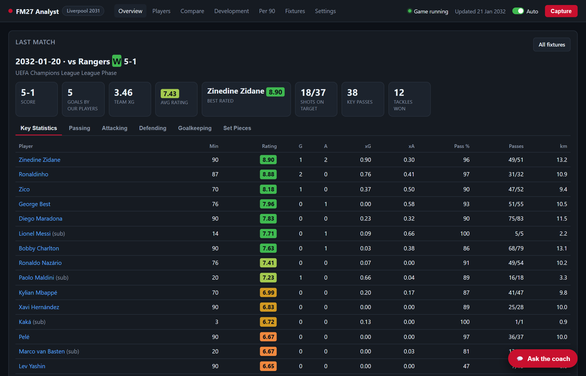 <b>At the PC:</b> the Overview while you play.</td>
<td width="21%">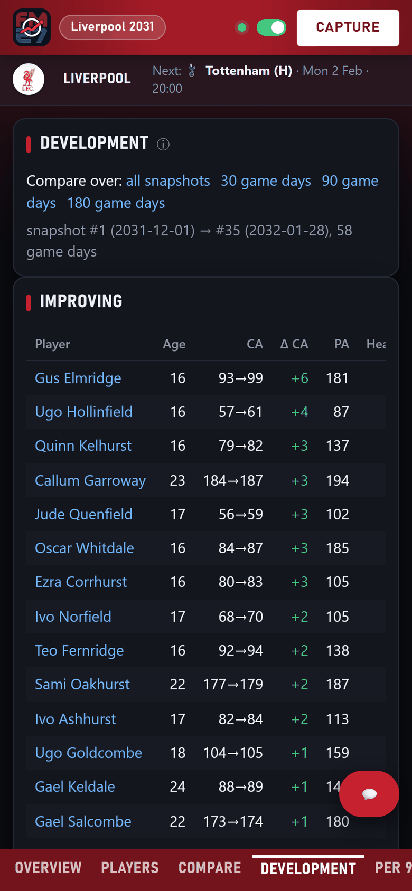 <b>On the phone:</b> development.</td>
<td width="21%">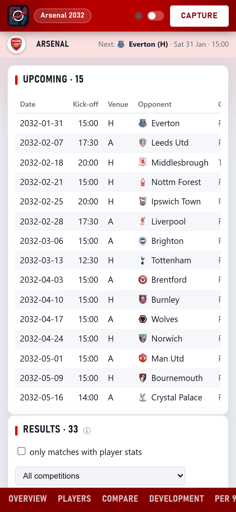 <b>Planning ahead:</b> fixtures.</td>
</tr>
</table>

### Shortlist: follow your transfer targets
Make a shortlist called **FM Analyst** in FM27 and add the players you're thinking of buying. The new **Shortlist**
tab follows them from then on, at every capture:
- **The list:** age, position, club (and loan), CA and PA, value and its change since you started tracking, wage,
  contract end and time left, with a breakdown by position (click one to filter).
- **Go for them now:** who to bid for at the moment, and why: final year of the contract (or under 6 months: free
  soon, or a pre-contract), value falling, or CA rising fast before the price follows.
- **A page for each player:** value, contract left, CA/PA and wage over time, when-to-bid signals, how they'd rank in
  your team at their position, and every attribute with what's changed.

Only that one shortlist is read; take a player off it in the game and they're gone from the app at the next capture.
It works on the phone too. See [Shortlist](guide/dashboard.md#shortlist).

<table>
<tr>
<td width="58%">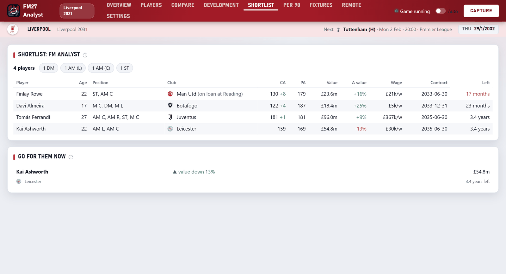 The list and who to go for now</td>
<td width="21%">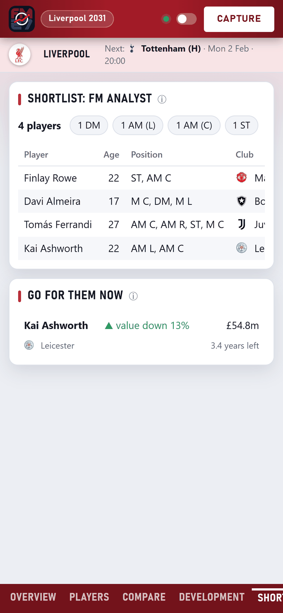 On the phone</td>
<td width="21%">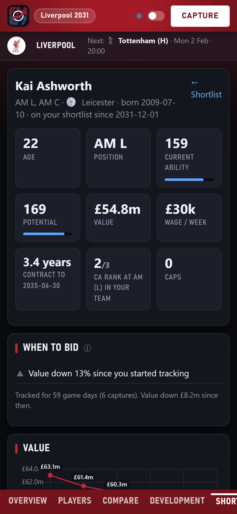 A player</td>
</tr>
</table>

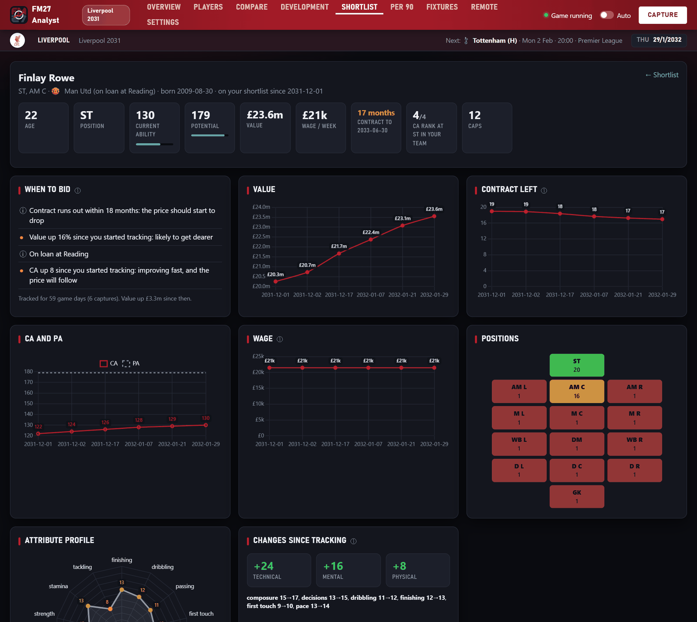

### Remote play
**Play FM27 from your phone.** The phone shows a live picture of the game and turns your taps into mouse clicks and
key presses on the PC. Read the inbox, pick the team, change tactics, press Continue and watch matches from the sofa,
or from anywhere over Tailscale. It only sends input, the way you would at the PC; it never writes to game memory.

- **Touch or Mouse mode.** Tap to click, pinch to zoom, press and hold for a magnifier, drag for the tactics pitch,
  scroll with one finger, and a minimap to jump around.
- **Smooth video** at Low, Medium or High (5, 10 or 16 Mbit/s), using your graphics card's encoder (NVIDIA or Intel),
  or still pictures.
- **FM27's own shortcuts** in a row along the bottom: Continue, Portal, Squad, Tactics, News and Save.
- **Alerts.** When FM27 stops processing and needs you, the phone chimes, buzzes and shows FM27's own button
  ("Continue", "Go To Match"). Over Tailscale HTTPS it can also send a phone notification with the page closed.
- **Install it** on the Home Screen and play full screen.
- **Safe by design.** Paired phones only, home Wi-Fi or Tailscale only, never the open internet. Shortcut buttons can
  only send a fixed set of keys.

Turn it on in the analyst's new **Remote** tab. It needs a few extra packages, installed once:
`.venv\Scripts\python -m pip install -r remote\requirements.txt`.
Full guide: [Remote play](guide/remote-play.md).

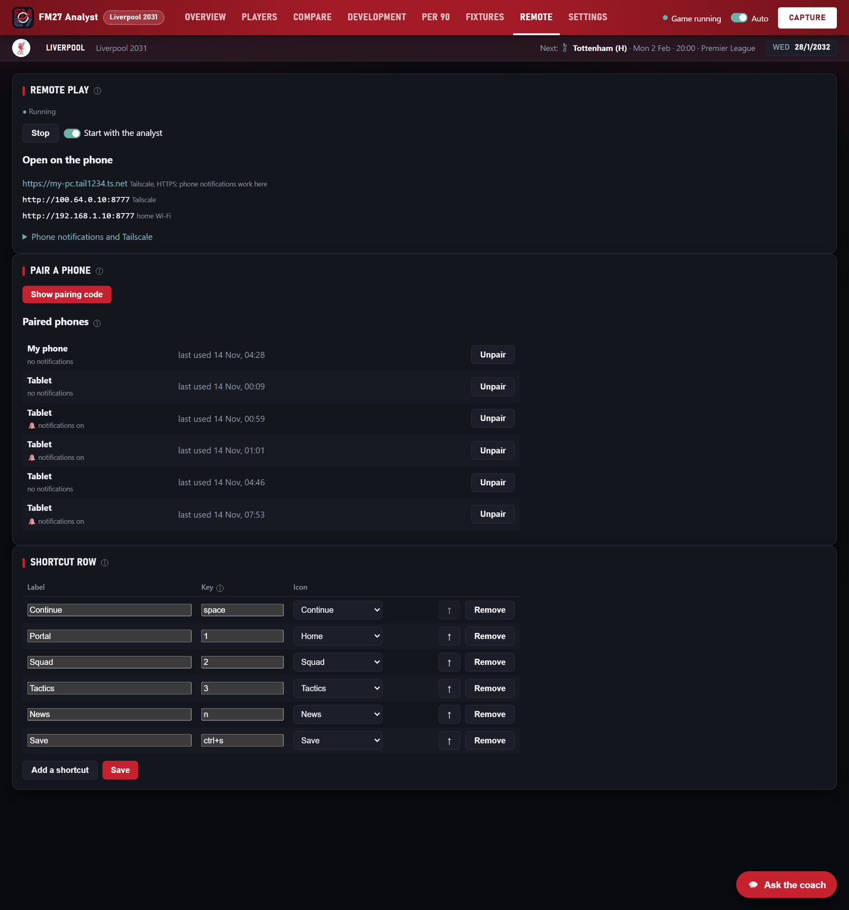

### The analyst and the coach inside remote play
**App** in remote play opens the analyst over the game, so you never have to leave it:
- **Next match:** suggested changes, who to rest, fitness alerts;
- **Squad:** condition, sharpness and form for every player, sortable;
- **Fixtures:** the next ten matches and the last ten results;
- **💬 Ask the coach:** the AI coach, with the provider you set in the analyst. Conversations are saved there too.
  This button only shows when the coach is set up.

**Update** captures FM27 straight away, and **Analyst** switches to the full phone app and back.

<table>
<tr>
<td width="33%">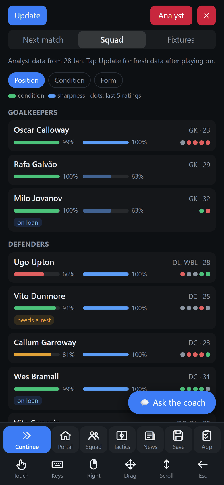 Squad</td>
<td width="33%">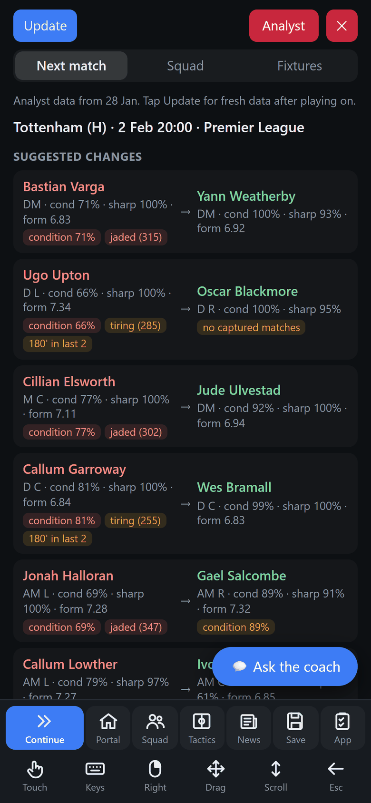 Next match</td>
<td width="33%">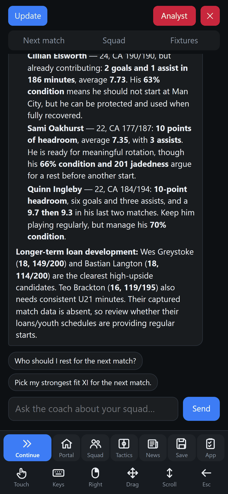 The coach</td>
</tr>
</table>

### Back and Forward gestures
Draw a full circle on the picture with one finger: **anticlockwise goes Back, clockwise goes Forward**, like the side
buttons on a mouse. A label flashes to show which one was sent. It works in Touch and Mouse mode.
See [On the phone](guide/remote-play.md#on-the-phone).

### Phone app and remote play together
Phones already set up with the [phone app](guide/phone.md) don't need to pair again. In **Settings › Phone**, each
paired phone has two switches: **Remote play on home Wi-Fi** and **Remote play over Tailscale**. The phone app's
**Remote** tab then opens remote play in one tap, already paired. Turning a switch off, or revoking the phone, cuts it
off within seconds. Any other phone pairs by scanning a QR code in the Remote tab.
See [Pairing a phone](guide/remote-play.md#pairing-a-phone).

### Access from your devices
A new card in **Settings › Phone**, after the setup guide, lists the addresses your devices can open:
- your **Tailscale** name (MagicDNS) and address when Tailscale is connected on the PC, for use anywhere;
- how to set Tailscale up, if it isn't;
- your **home Wi-Fi** address, for use at home only.

It reminds you to pair the device first (**Pair a device**), warns when your **Only accept connections from** setting
would block an address, and links to the guides. See [Settings › Phone](guide/phone.md#settings--phone).

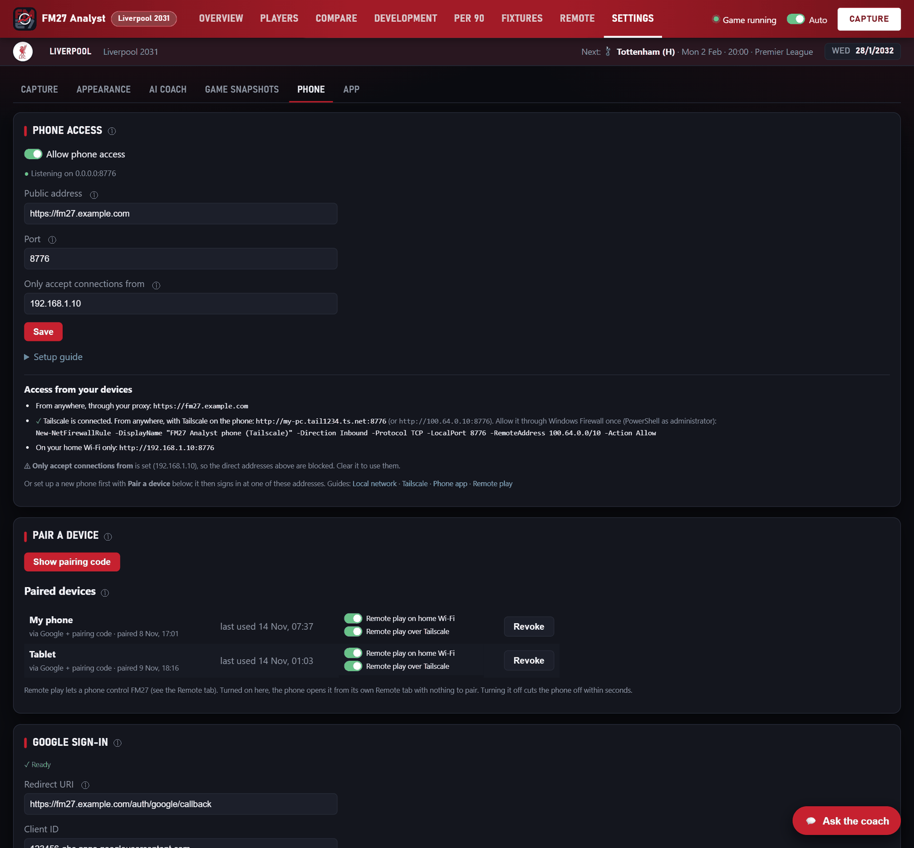

### Club crests
If you've installed a logo pack for FM27 (TCM, FMG and so on), the app shows the same crests: your club in the
header, opponents in fixtures and match reports, and in remote play. Without one it shows initials, as before.
**Settings › Appearance** says how many crests it found. If your FM27 user folder isn't in Documents, paste its
`graphics` folder there. See [Appearance](guide/getting-started.md#appearance).

### New logo, more themes
A new app logo (FM27 block letters, a centre circle and a form line) in the header, the shortcuts and the phone's
Home Screen. The theme still follows your club's colours, in dark or light mode, on the PC and the phone:

<table>
<tr>
<td width="50%">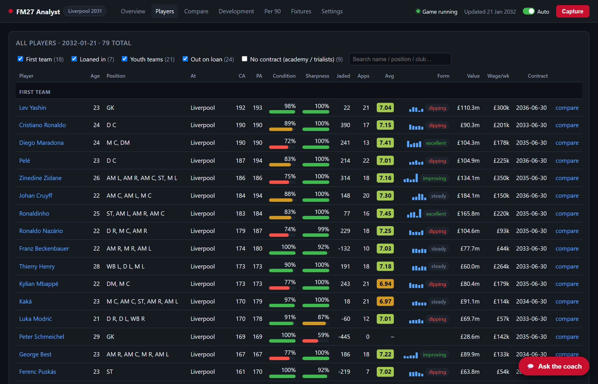 Players, light</td>
<td width="50%">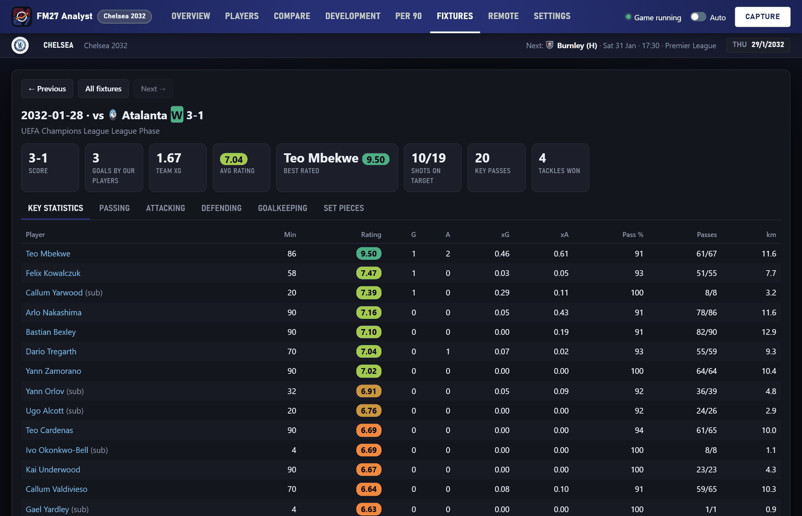 Match report, dark</td>
</tr>
<tr>
<td>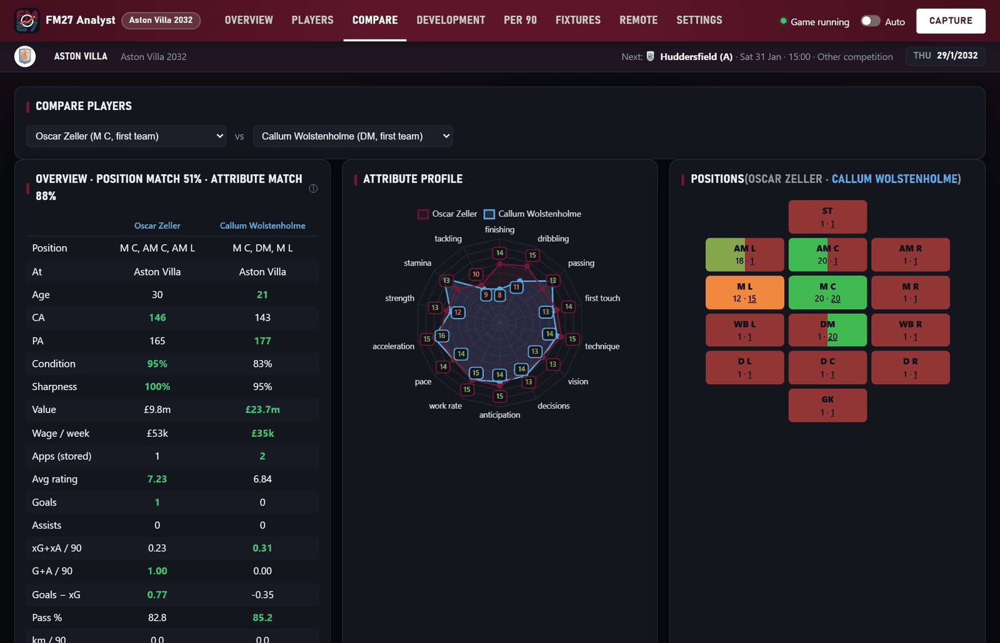 Compare, dark</td>
<td>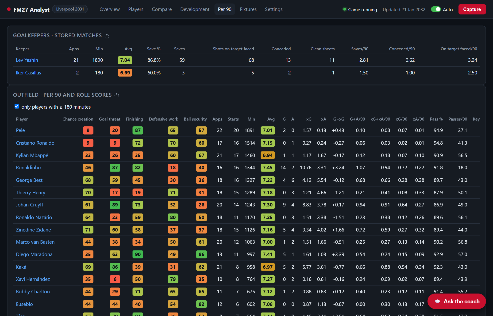 Per 90, light</td>
</tr>
</table>

### Settings anyone can use
Everything is set up from inside the app, with your own accounts and addresses; no files to edit:
- **Remote tab › Shortcut row:** rename, reorder, remove or add buttons (up to 8), each with a key and an icon.
  **Back to the defaults** undoes it.
- **Settings › Appearance › FM27 graphics folder:** for logo packs outside Documents.
- **Settings › Phone › Access from your devices:** the addresses to use (above).
- **Settings › App** shows the version and links here.

### Smaller changes and fixes
- **Ask the coach** buttons only show once the AI coach is set up (**Settings › AI coach**), on the PC, the phone and
  in remote play.
- Plainer wording for auto-capture.
- Remote play: opening it straight into Mouse mode no longer keeps reconnecting with the cursor stuck in the corner.

### Game updates
- Works with the latest FM27 update (build `df0c5c4104b2`). The app checked that its offsets for the 11 November
  build still fit, and carried on by itself.
- The profiles for the release build (`e6edaa71ecd9`) and the 11 November build (`f2bf83294162`) are still included.

## Earlier: the 1.0.0 betas
- **[Beta 4](https://github.com/lastrider04/FM27-Analyst/releases/tag/v1.0.0-beta.4)** (11 November): works with
  the 11 November FM27 update.
- **[Beta 3](https://github.com/lastrider04/FM27-Analyst/releases/tag/v1.0.0-beta.3)** (8 November): the new look,
  with club colours, dark and light modes, and Appearance settings.
- **[Betas 1 and 2](https://github.com/lastrider04/FM27-Analyst/releases/tag/v1.0.0-beta.2)** (8 November): the
  first release: captures, dashboard, AI coach and phone app.
