# Updates

[Guide index](../README.md#guide) · [Releases](https://github.com/lastrider04/FM27-Analyst/releases)

- [1.0.2: out of beta](#102-out-of-beta) (14 November 2026)
- [Earlier: the 1.0.0 betas](#earlier-the-100-betas)

## 1.0.2: out of beta
FM27 Analyst is out of beta. The big new feature is **remote play**: play FM27 from your phone, with the analyst's
data and the AI coach a tap away. There are also club crests, a new logo, and settings that anyone can set up from
inside the app.

**Updating:** quit the app, extract the new version over your existing folder (your `data\` folder is kept), and run
`install.bat` again. For remote play, also install its extra packages once (see [Remote play](#remote-play)).

- [Where it fits in your game](#where-it-fits-in-your-game)
- [Remote play](#remote-play)
- [The analyst and the coach inside remote play](#the-analyst-and-the-coach-inside-remote-play)
- [Back and Forward gestures](#back-and-forward-gestures)
- [Phone app and remote play together](#phone-app-and-remote-play-together)
- [Access from your devices](#access-from-your-devices)
- [Club crests](#club-crests)
- [New logo, more themes](#new-logo-more-themes)
- [Settings anyone can use](#settings-anyone-can-use)
- [Smaller changes and fixes](#smaller-changes-and-fixes)
- [Game updates](#game-updates)

### Where it fits in your game
The same history, in four places:

| When | Use | |
|---|---|---|
| **At the PC, while you play** | The dashboard on a second screen or alongside FM27: form, condition, per 90s and match reports, updated after every match. | [Dashboard](guide/dashboard.md) |
| **On your phone, on the sofa** | The phone app: your squad, development, fixtures and the coach, while FM27 sits on the PC. | [Phone app](guide/phone.md) |
| **Away from the PC** | Leave the PC running and plan ahead from anywhere: who's improving, who needs a rest, what's coming up. Ask the coach on the bus. | [Tailscale](guide/phone-tailscale.md) |
| **Away from the PC, and want to play** | Pick the game up on your phone with remote play, and carry on where you left off. | [Remote play](guide/remote-play.md) |

<table>
<tr>
<td width="58%">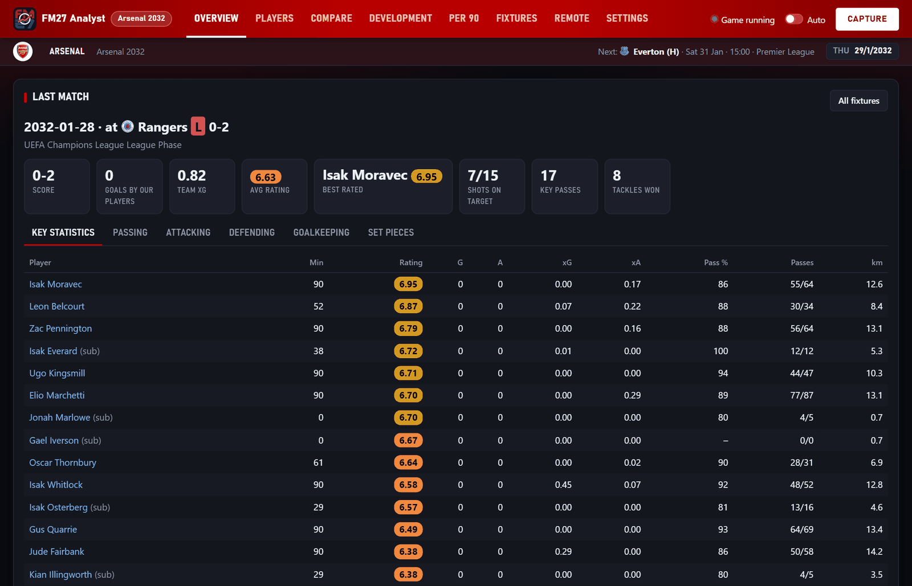 <b>At the PC:</b> the Overview while you play.</td>
<td width="21%">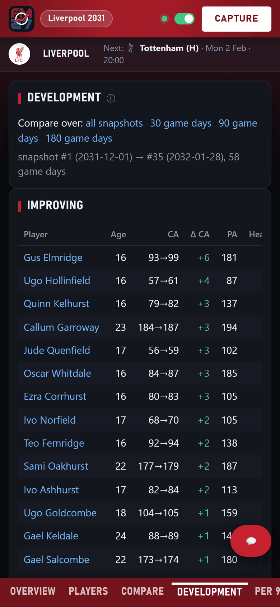 <b>On the phone:</b> development.</td>
<td width="21%">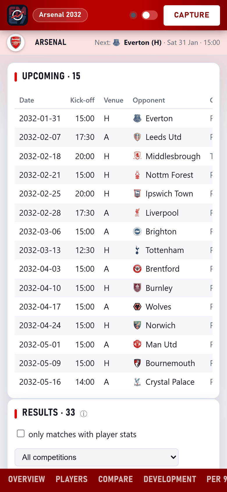 <b>Planning ahead:</b> fixtures.</td>
</tr>
</table>

### Remote play
**Play FM27 from your phone.** The phone shows a live picture of the game and turns your taps into mouse clicks and
key presses on the PC. Read the inbox, pick the team, change tactics, press Continue and watch matches from the sofa,
or from anywhere over Tailscale. It only sends input, the way you would at the PC; it never writes to game memory.

- **Touch or Mouse mode.** Tap to click, pinch to zoom, press and hold for a magnifier, drag for the tactics pitch,
  scroll with one finger, and a minimap to jump around.
- **Smooth video** at Low, Medium or High (5, 10 or 16 Mbit/s), using your graphics card's encoder (NVIDIA or Intel),
  or still pictures.
- **FM27's own shortcuts** in a row along the bottom: Continue, Portal, Squad, Tactics, News and Save.
- **Alerts.** When FM27 stops processing and needs you, the phone chimes, buzzes and shows FM27's own button
  ("Continue", "Go To Match"). Over Tailscale HTTPS it can also send a phone notification with the page closed.
- **Install it** on the Home Screen and play full screen.
- **Safe by design.** Paired phones only, home Wi-Fi or Tailscale only, never the open internet. Shortcut buttons can
  only send a fixed set of keys.

Turn it on in the analyst's new **Remote** tab. It needs a few extra packages, installed once:
`.venv\Scripts\python -m pip install -r remote\requirements.txt`.
Full guide: [Remote play](guide/remote-play.md).

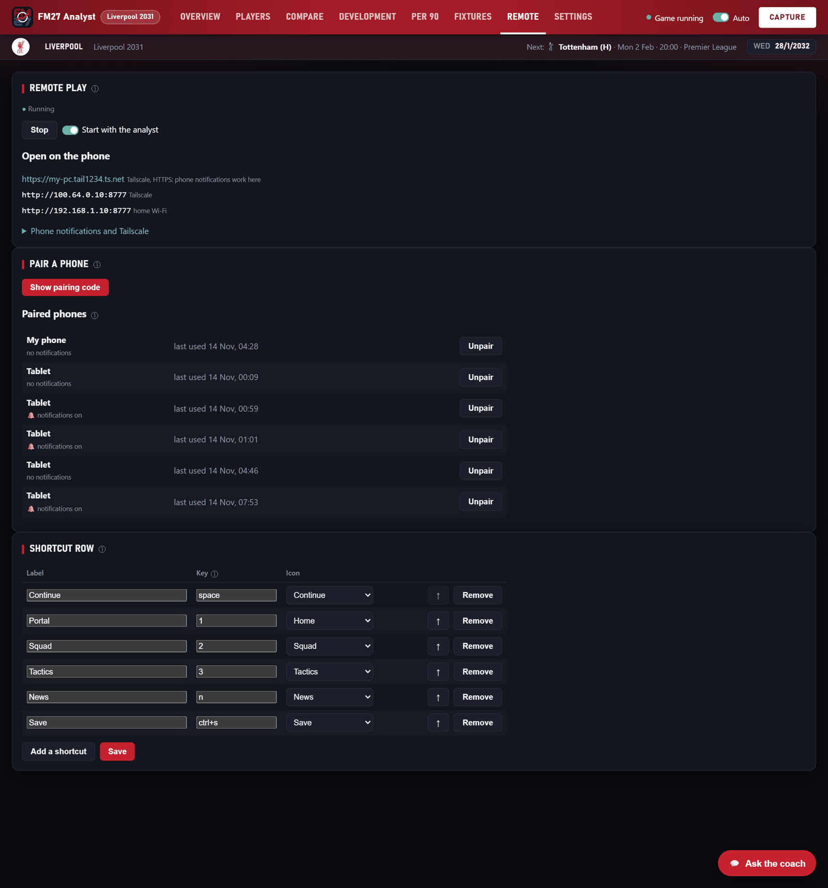

### The analyst and the coach inside remote play
**App** in remote play opens the analyst over the game, so you never have to leave it:
- **Next match:** suggested changes, who to rest, fitness alerts;
- **Squad:** condition, sharpness and form for every player, sortable;
- **Fixtures:** the next ten matches and the last ten results;
- **💬 Ask the coach:** the AI coach, with the provider you set in the analyst. Conversations are saved there too.
  This button only shows when the coach is set up.

**Update** captures FM27 straight away, and **Analyst** switches to the full phone app and back.

<table>
<tr>
<td width="33%">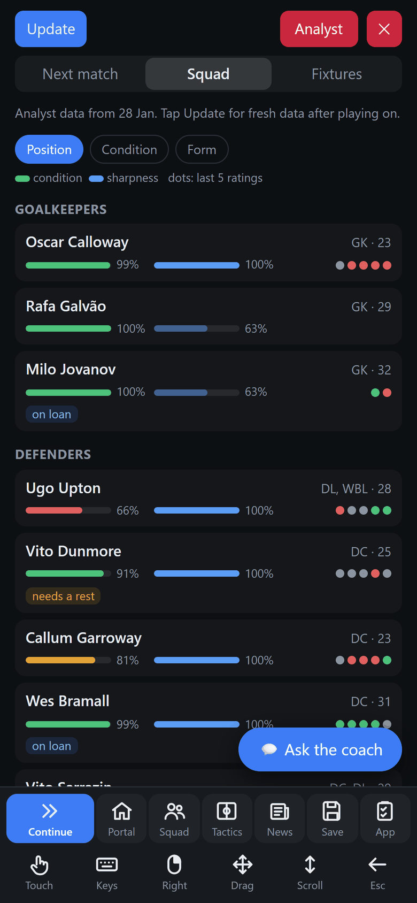 Squad</td>
<td width="33%">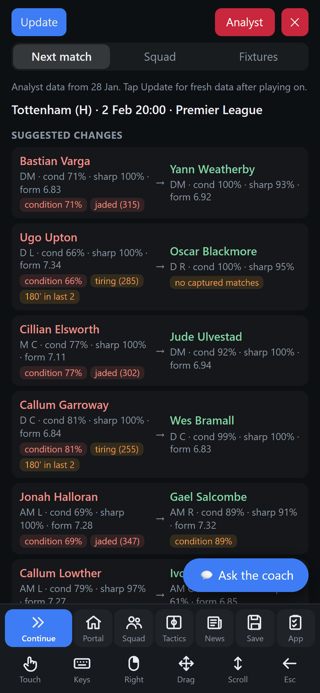 Next match</td>
<td width="33%">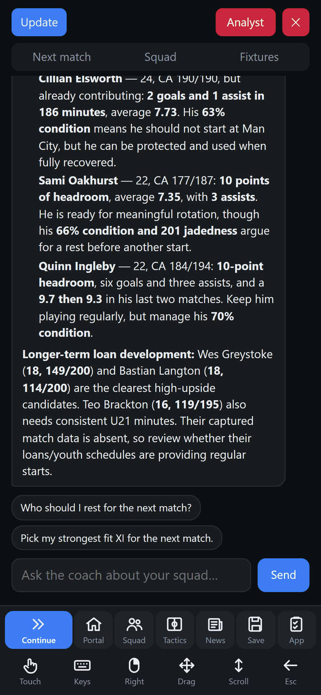 The coach</td>
</tr>
</table>

### Back and Forward gestures
Draw a full circle on the picture with one finger: **anticlockwise goes Back, clockwise goes Forward**, like the side
buttons on a mouse. A label flashes to show which one was sent. It works in Touch and Mouse mode.
See [On the phone](guide/remote-play.md#on-the-phone).

### Phone app and remote play together
Phones already set up with the [phone app](guide/phone.md) don't need to pair again. In **Settings › Phone**, each
paired phone has two switches: **Remote play on home Wi-Fi** and **Remote play over Tailscale**. The phone app's
**Remote** tab then opens remote play in one tap, already paired. Turning a switch off, or revoking the phone, cuts it
off within seconds. Any other phone pairs by scanning a QR code in the Remote tab.
See [Pairing a phone](guide/remote-play.md#pairing-a-phone).

### Access from your devices
A new card in **Settings › Phone**, after the setup guide, lists the addresses your devices can open:
- your **Tailscale** name (MagicDNS) and address when Tailscale is connected on the PC, for use anywhere;
- how to set Tailscale up, if it isn't;
- your **home Wi-Fi** address, for use at home only.

It reminds you to pair the device first (**Pair a device**), warns when your **Only accept connections from** setting
would block an address, and links to the guides. See [Settings › Phone](guide/phone.md#settings--phone).

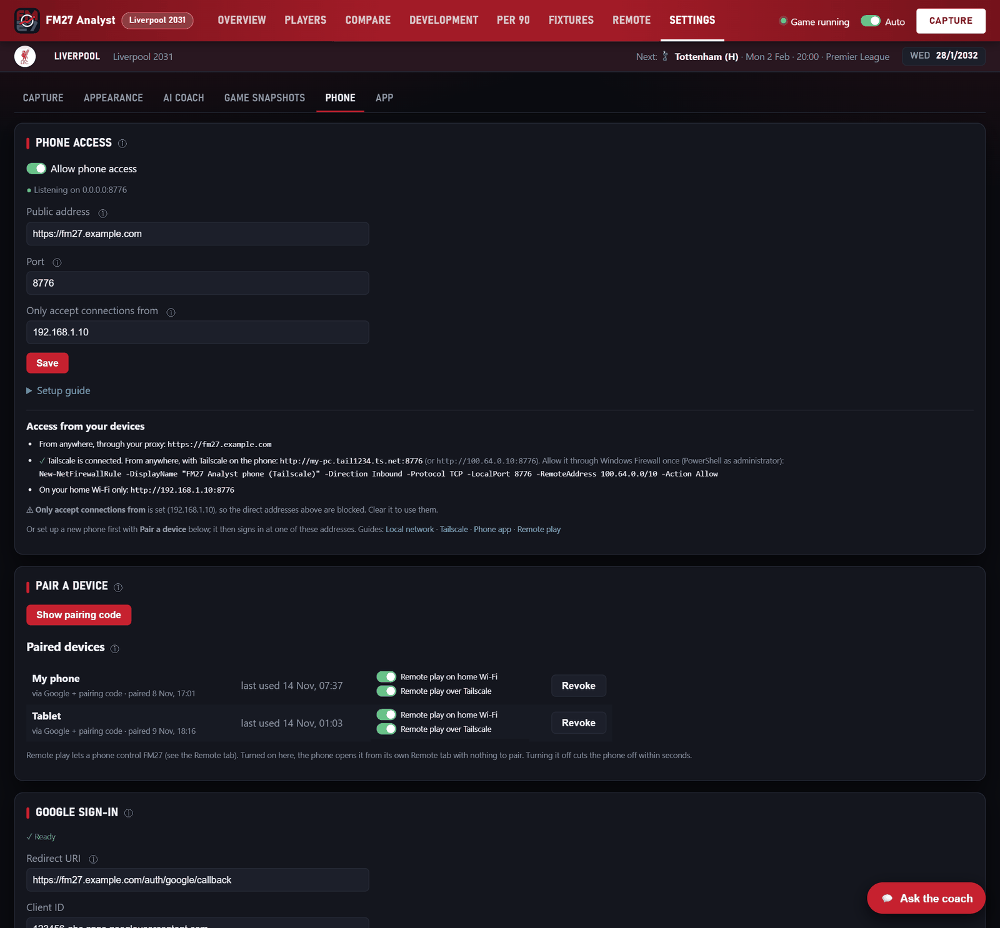

### Club crests
If you've installed a logo pack for FM27 (TCM, FMG and so on), the app shows the same crests: your club in the
header, opponents in fixtures and match reports, and in remote play. Without one it shows initials, as before.
**Settings › Appearance** says how many crests it found. If your FM27 user folder isn't in Documents, paste its
`graphics` folder there. See [Appearance](guide/getting-started.md#appearance).

### New logo, more themes
A new app logo (FM27 block letters, a centre circle and a form line) in the header, the shortcuts and the phone's
Home Screen. The theme still follows your club's colours, in dark or light mode, on the PC and the phone:

<table>
<tr>
<td width="50%">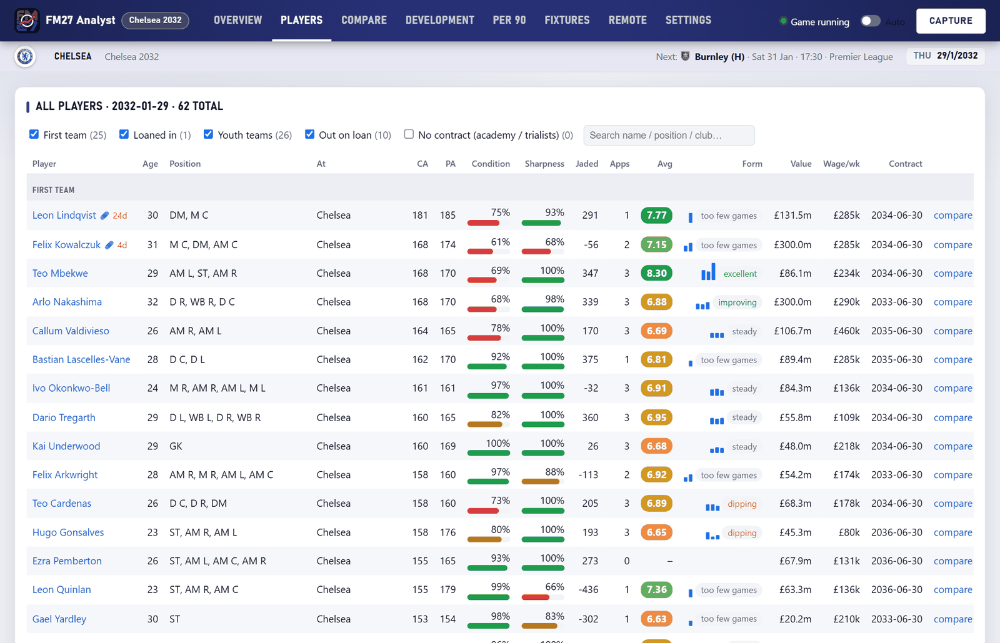 Players, light</td>
<td width="50%">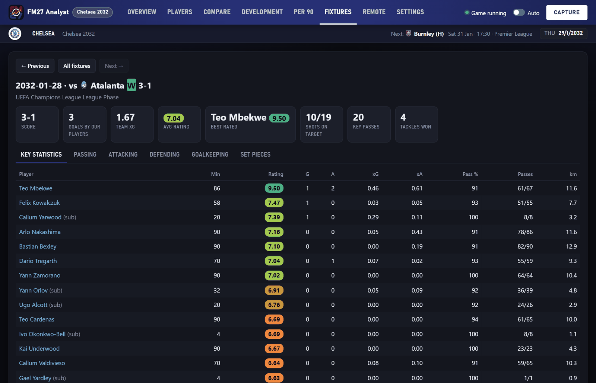 Match report, dark</td>
</tr>
<tr>
<td>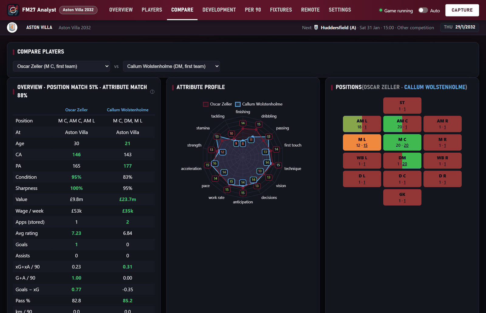 Compare, dark</td>
<td>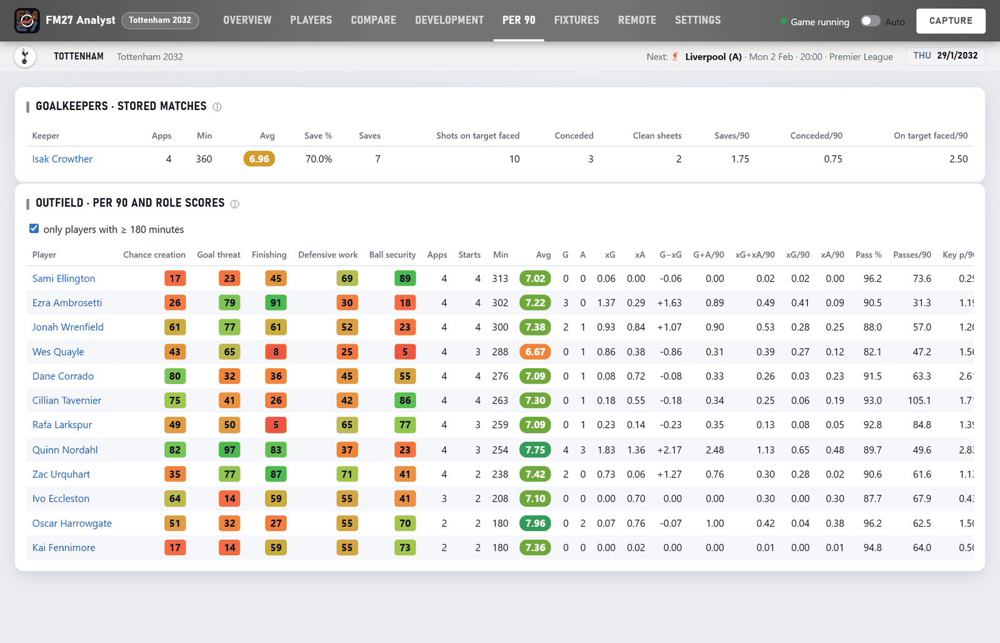 Per 90, light</td>
</tr>
</table>

### Settings anyone can use
Everything is set up from inside the app, with your own accounts and addresses; no files to edit:
- **Remote tab › Shortcut row:** rename, reorder, remove or add buttons (up to 8), each with a key and an icon.
  **Back to the defaults** undoes it.
- **Settings › Appearance › FM27 graphics folder:** for logo packs outside Documents.
- **Settings › Phone › Access from your devices:** the addresses to use (above).
- **Settings › App** shows the version and links here.

### Smaller changes and fixes
- **Ask the coach** buttons only show once the AI coach is set up (**Settings › AI coach**), on the PC, the phone and
  in remote play.
- Plainer wording for auto-capture.
- Remote play: opening it straight into Mouse mode no longer keeps reconnecting with the cursor stuck in the corner.

### Game updates
- Works with the latest FM27 update (build `df0c5c4104b2`). The app checked that its offsets for the 11 November
  build still fit, and carried on by itself.
- The profiles for the release build (`e6edaa71ecd9`) and the 11 November build (`f2bf83294162`) are still included.

## Earlier: the 1.0.0 betas
- **[Beta 4](https://github.com/lastrider04/FM27-Analyst/releases/tag/v1.0.0-beta.4)** (11 November): works with
  the 11 November FM27 update.
- **[Beta 3](https://github.com/lastrider04/FM27-Analyst/releases/tag/v1.0.0-beta.3)** (8 November): the new look,
  with club colours, dark and light modes, and Appearance settings.
- **[Betas 1 and 2](https://github.com/lastrider04/FM27-Analyst/releases/tag/v1.0.0-beta.2)** (8 November): the
  first release: captures, dashboard, AI coach and phone app.
